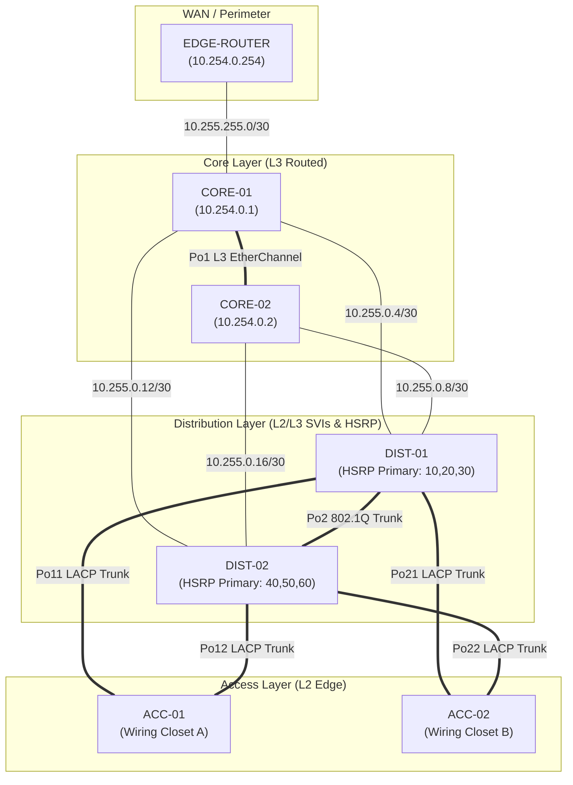

# Physical and Logical Topology Reference

This document maps the exact interface cabling, link types, EtherChannels, and IP allocations for simulating the network in **Cisco Packet Tracer**, **GNS3**, or **EVE-NG**.

---

## 1. Device Inventory & Roles

| Device Name | Hardware Role | Recommended Packet Tracer Model | Recommended GNS3 Image | Loopback0 (Router-ID) |
| :--- | :--- | :--- | :--- | :--- |
| **CORE-01** | Core Multilayer Switch | Catalyst 3650-24PS or 3560-24PS | Cisco IOU L3 / Cisco vIOS-L3 | `10.254.0.1/32` |
| **CORE-02** | Core Multilayer Switch | Catalyst 3650-24PS or 3560-24PS | Cisco IOU L3 / Cisco vIOS-L3 | `10.254.0.2/32` |
| **DIST-01** | Distribution Multilayer Switch | Catalyst 3650-24PS or 3560-24PS | Cisco IOU L3 / Cisco vIOS-L3 | `10.254.0.11/32` |
| **DIST-02** | Distribution Multilayer Switch | Catalyst 3650-24PS or 3560-24PS | Cisco IOU L3 / Cisco vIOS-L3 | `10.254.0.12/32` |
| **ACC-01** | Access Layer Switch 1 | Catalyst 2960-24TT | Cisco IOU L2 / Cisco vIOS-L2 | `10.10.10.11/24` (SVI 10) |
| **ACC-02** | Access Layer Switch 2 | Catalyst 2960-24TT | Cisco IOU L2 / Cisco vIOS-L2 | `10.10.10.12/24` (SVI 10) |
| **EDGE-ROUTER** | Campus Border / WAN Router | Cisco 2911 or 4331 ISR | Cisco c7200 / Cisco vIOS | `10.254.0.254/32` |

---

## 2. Point-to-Point Routed Cabling Table (Core & Distribution)

All links between Core and Distribution are routed point-to-point Layer 3 links (`no switchport`):

| Source Device | Source Port | Target Device | Target Port | Subnet | IP (Source) | IP (Target) |
| :--- | :--- | :--- | :--- | :--- | :--- | :--- |
| **CORE-01** | Gi1/0/23 | **CORE-02** | Gi1/0/23 | `10.255.0.0/30` (Po1) | `10.255.0.1` | `10.255.0.2` |
| **CORE-01** | Gi1/0/24 | **CORE-02** | Gi1/0/24 | `10.255.0.0/30` (Po1) | *(Port-Channel 1 member)* | *(Port-Channel 1 member)* |
| **CORE-01** | Gi1/0/1 | **DIST-01** | Gi1/0/1 | `10.255.0.4/30` | `10.255.0.5` | `10.255.0.6` |
| **CORE-01** | Gi1/0/2 | **DIST-02** | Gi1/0/1 | `10.255.0.12/30`| `10.255.0.13`| `10.255.0.14`|
| **CORE-02** | Gi1/0/1 | **DIST-01** | Gi1/0/2 | `10.255.0.8/30` | `10.255.0.9` | `10.255.0.10`|
| **CORE-02** | Gi1/0/2 | **DIST-02** | Gi1/0/2 | `10.255.0.16/30`| `10.255.0.17`| `10.255.0.18`|
| **CORE-01** | Gi1/0/10 | **EDGE-ROUTER** | Gi0/0/0 | `10.255.255.0/30`| `10.255.255.2`| `10.255.255.1`|

---

## 3. Layer 2 Trunk & EtherChannel Cabling Table (Dist & Access)

Links between Distribution and Access switches operate as 802.1Q IEEE trunk links with LACP (802.3ad) EtherChannel:

| Channel Group | Source Switch | Source Ports | Target Switch | Target Ports | Mode | Native VLAN |
| :---: | :--- | :--- | :--- | :--- | :--- | :---: |
| **Po2** | **DIST-01** | Gi1/0/23, Gi1/0/24 | **DIST-02** | Gi1/0/23, Gi1/0/24 | 802.1Q Trunk (LACP active) | 99 |
| **Po11** | **DIST-01** | Gi1/0/11, Gi1/0/12 | **ACC-01** | Gi0/1, Gi0/2 | 802.1Q Trunk (LACP active) | 99 |
| **Po12** | **DIST-02** | Gi1/0/11, Gi1/0/12 | **ACC-01** | Gi0/3, Gi0/4 | 802.1Q Trunk (LACP active) | 99 |
| **Po21** | **DIST-01** | Gi1/0/13, Gi1/0/14 | **ACC-02** | Gi0/1, Gi0/2 | 802.1Q Trunk (LACP active) | 99 |
| **Po22** | **DIST-02** | Gi1/0/13, Gi1/0/14 | **ACC-02** | Gi0/3, Gi0/4 | 802.1Q Trunk (LACP active) | 99 |

---

## 4. Host Access Port Allocations (ACC-01 & ACC-02)

| Switch | Port Range | Assigned VLAN | Department | Security / Features |
| :--- | :--- | :---: | :--- | :--- |
| **ACC-01** | Fa0/1 - Fa0/5 | **20** | HR Workstations | PortFast, BPDU Guard, Access Mode |
| **ACC-01** | Fa0/6 - Fa0/10 | **30** | IT & Engineering | PortFast, BPDU Guard, Access Mode |
| **ACC-01** | Fa0/11 - Fa0/15 | **40** | Finance & Accounting | PortFast, BPDU Guard, Access Mode |
| **ACC-01** | Fa0/16 - Fa0/20 | **50** | Executive Offices | PortFast, BPDU Guard, Access Mode |
| **ACC-01** | Fa0/21 - Fa0/24 | **60** | Guest Wi-Fi APs / Ports | PortFast, BPDU Guard, Access Mode |
| **ACC-02** | Fa0/1 - Fa0/5 | **20** | HR Workstations | PortFast, BPDU Guard, Access Mode |
| **ACC-02** | Fa0/6 - Fa0/10 | **30** | IT & Engineering | PortFast, BPDU Guard, Access Mode |
| **ACC-02** | Fa0/11 - Fa0/15 | **40** | Finance & Accounting | PortFast, BPDU Guard, Access Mode |
| **ACC-02** | Fa0/16 - Fa0/20 | **50** | Executive Offices | PortFast, BPDU Guard, Access Mode |
| **ACC-02** | Fa0/21 - Fa0/24 | **60** | Guest Wi-Fi APs / Ports | PortFast, BPDU Guard, Access Mode |

---

## 5. Visual Topology Diagram

